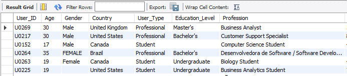

# 📊 Proyecto MySQL : Uso de la IA e impacto en estudiantes y profesionales 

## 📌 Descripción del Proyecto
El conjunto de datos Uso e impacto de la IA en estudiantes y profesionales analiza cómo distintos perfiles de usuarios emplean herramientas de inteligencia artificial en sus estudios, trabajo y vida diaria. Mi objetivo es analizar y comparar los patrones de adopción, uso e impacto de la inteligencia artificial entre estudiantes y profesionales mediante consultas SQL en MySQL, estructurando y validando los datos para identificar qué herramientas, propósitos y niveles de experiencia se asocian con una mayor productividad, precisión, satisfacción y ahorro de tiempo.

## 🗂️Estructura del Proyecto

- [Sobre los Datos](#sobre-los-datos)
- [Tareas](#tareas)
- [Limpieza de Datos](#limpieza-de-datos)
- [Análisis Exploratorio de Datos e Insights](#análisis-exploratorio-de-datos-e-insights)

## Sobre los Datos
Los datos originales, junto con una explicación de cada columna, se pueden encontrar  [aquí](https://www.kaggle.com/datasets/eishatuzzuhra/ai-usage-and-impact-on-students-and-professionals)
El conjunto de datos incluye una sola tabla con datos que contiene información demográfica como edad, género, país, nivel educativo y profesión, junto con información sobre ingresos y tipo de usuario, distribuidos en 300 registros y 19 columnas.

## Tareas (Task)

En este análisis, ayudo a saber el uso de la IA con responder lo siguiente:

1. **Perfil de Usuarios:** ¿Cuál es la distribución de usuarios según tipo (Student vs. Professional), país, nivel educativo y género?
2. **Horas de Uso:** ¿Cuál es el promedio de horas diarias de uso de IA (AI_Usage_Hours_Per_Day) en estudiantes frente a profesionales?
3. **Herramientas Preferidas:** ¿Cuáles son las herramientas de IA más utilizadas en general y qué herramienta lidera en cada tipo de usuario (AI_Tool)?
4. **Propósito de Uso:** ¿Para qué actividades (AI_Purpose) se utiliza más la IA y cuál presenta mayor tiempo promedio de uso diario?
5. **Productividad y Precisión:** ¿Cómo varían el puntaje de productividad (Productivity_Score) y la calificación de precisión (Accuracy_Rating) según la herramienta de IA o el propósito de uso?
6. **Ahorro de Tiempo:** ¿Cuántas horas a la semana (Time_Saved_Hours_Per_Week) ahorran en promedio los usuarios y cómo se compara este ahorro frente a sus horas de estudio o trabajo (Work_or_Study_Hours_Per_Day)?
7. **Inversión vs. Impacto:** ¿Existe diferencia en productividad, satisfacción (Satisfaction_Score) y ahorro de tiempo entre quienes pagan por IA (Monthly_AI_Cost > 0) y quienes usan planes gratuitos (Monthly_AI_Cost = 0)?
8. **Nivel de Satisfacción y Recomendación:** ¿Cuál es el promedio de Satisfaction_Score por tipo de usuario y qué porcentaje recomienda la herramienta (Would_Recommend = 'Yes')?
9. **Top Profesiones / Roles:** Identificar las profesiones o áreas de estudio con mayor promedio de uso diario de IA o mayor tiempo ahorrado por semana
10. **Segmentación por Intensidad:** Categorizar a los usuarios según su nivel de uso diario de IA (por ejemplo, Bajo, Moderado y Alto) y comparar su productividad promedio y nivel de recomendación en cada categoría.

## Limpieza de Datos
Antes de realizar el análisis, es fundamental realizar una transformacion y limpieza de datos en excel con Power Query

